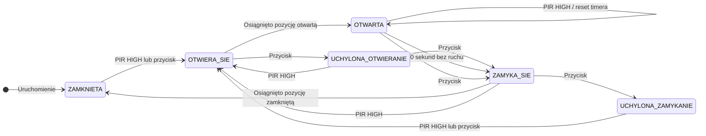

# 🚧 Automatyczna brama – maszyna stanów

Projekt edukacyjny realizowany na lekcji **Mikrokontrolery** z wykorzystaniem Arduino UNO i środowiska Tinkercad.

## 📌 1. Opis projektu

Celem projektu jest stworzenie automatycznej bramy składającej się z dwóch skrzydeł sterowanych za pomocą dwóch mikroserwomechanizmów.

Brama może być obsługiwana na dwa sposoby:

- **Automatycznie** – za pomocą czujnika ruchu PIR.
- **Ręcznie** – za pomocą przycisku.

Sterowanie bramą zostało oparte na koncepcji **maszyny stanów (Finite State Machine – FSM)**. Każdy stan odpowiada określonej sytuacji, w której znajduje się brama.

## 🔧 2. Wykorzystane komponenty

| Komponent | Zastosowanie |
| --- | --- |
| Arduino UNO | Główny mikrokontroler |
| 2 × mikroserwo | Sterowanie lewym i prawym skrzydłem |
| Czujnik PIR | Wykrywanie ruchu |
| Przycisk | Ręczne sterowanie bramą |
| Dioda LED | Sygnalizacja ruchu bramy |
| Rezystor | Ograniczenie prądu diody LED |

## 🔌 3. Schemat podłączenia

| Element | Pin Arduino |
| --- | --- |
| Przycisk | D2 |
| Lewe mikroserwo – sygnał | D9 |
| Prawe mikroserwo – sygnał | D10 |
| Dioda LED | D6 |
| PIR – sygnał OUT | D4 |
| PIR – zasilanie VCC | 5V |
| PIR – masa GND | GND |

Dodatkowo:

- Oba mikroserwa mają wspólną masę.
- Zasilanie mikroserw podłączone jest do 5V w układzie demonstracyjnym.
- Przycisk korzysta z wewnętrznego rezystora podciągającego `INPUT_PULLUP`.
- Dioda LED jest podłączona przez rezystor.

## ⚙️ 4. Zasada działania

Brama posiada sześć podstawowych stanów:

| Numer | Nazwa stanu | Opis |
| --- | --- | --- |
| 1 | `ST_ZAMKNIETA` | Brama jest zamknięta i oczekuje na zdarzenie |
| 2 | `ST_OTWARTA` | Brama jest otwarta i odlicza 10 sekund |
| 3 | `ST_UCHYLONA_OTWIERANIE` | Brama została zatrzymana podczas otwierania |
| 4 | `ST_UCHYLONA_ZAMYKANIE` | Brama została zatrzymana podczas zamykania |
| 5 | `ST_OTWIERA_SIE` | Brama wykonuje ruch otwierania |
| 6 | `ST_ZAMYKA_SIE` | Brama wykonuje ruch zamykania |

### Automatyczne otwieranie

1. Czujnik PIR wykrywa ruch człowieka.
2. Arduino odczytuje sygnał HIGH.
3. Maszyna przechodzi do stanu `ST_OTWIERA_SIE`.
4. Oba mikroserwa otwierają skrzydła bramy.
5. Po zakończeniu ruchu brama przechodzi do stanu `ST_OTWARTA`.

### Automatyczne zamykanie

1. Czujnik PIR przestaje wykrywać ruch.
2. Rozpoczyna się odliczanie 10 sekund.
3. Po upływie czasu brama przechodzi do stanu `ST_ZAMYKA_SIE`.
4. Jeżeli PIR ponownie wykryje ruch, brama rozpoczyna otwieranie.

### Sterowanie ręczne

Przycisk umożliwia:

- Otworzenie zamkniętej bramy.
- Zamknięcie otwartej bramy.
- Zatrzymanie bramy podczas ruchu.
- Zmianę kierunku ruchu po zatrzymaniu.

## 🔄 5. Diagram maszyny stanów

Poniższy diagram przedstawia przejścia pomiędzy wszystkimi sześcioma stanami.

mermaid

## 💻 6. Wykorzystane rozwiązania programistyczne

W projekcie zastosowano:

- `#define` – definiowanie nazw poszczególnych stanów i pinów.
- `switch(state)` – wybór aktualnego stanu maszyny.
- `case` – obsługa poszczególnych stanów.
- `millis()` – odmierzanie czasu bez zatrzymywania całego programu.
- `Servo.h` – biblioteka do sterowania mikroserwomechanizmami.
- `digitalRead()` – odczyt przycisku i czujnika PIR.
- `digitalWrite()` – sterowanie diodą LED.
- Debouncing – eliminacja zakłóceń przy odczycie przycisku.

## 💡 7. Sygnalizacja LED

Dioda LED informuje o aktualnym działaniu bramy:

- LED świeci – brama wykonuje ruch.
- LED nie świeci – brama stoi w miejscu.

## ⏱️ 8. Parametry projektu

| Parametr | Wartość |
| --- | --- |
| Czas automatycznego zamykania | 10 sekund |
| Czas kroku serwa | 15 ms |
| Eliminacja drgań przycisku | 50 ms |
| Kąt zamknięcia – lewe serwo | 90° |
| Kąt zamknięcia – prawe serwo | 90° |
| Kąt otwarcia – lewe serwo | 0° |
| Kąt otwarcia – prawe serwo | 180° |

